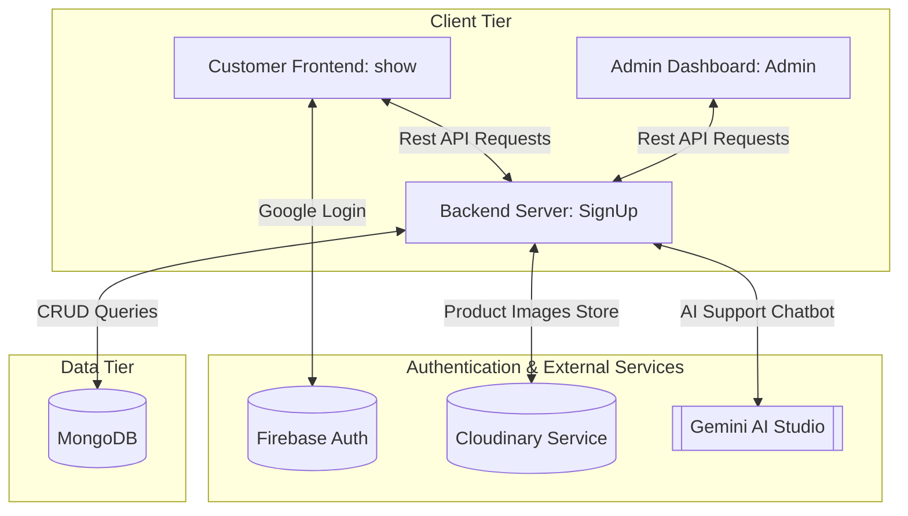

# 🧥 "Trylo." Virtual Try-On Clothing E-Commerce Web Application

Welcome to the **"Me."** E-commerce ecosystem. This project is a full-stack Virtual Try-On Clothing Web Application designed to provide customers with an interactive, modern online shopping experience, coupled with a powerful administration dashboard and a robust backend API service.

---

## 📂 Project Architecture & Directory Structure

The repository is structured as a monorepo consisting of three primary projects:

```
FYP-PROJECT/
├── Admin/             # 🛠️ Admin Dashboard Portal (React + Vite + Tailwind CSS v4)
├── show/              # 🛍️ Customer E-Commerce Storefront (React + Vite + Redux + Tailwind)
├── SignUp/            # ⚙️ REST API Backend Server (Node.js + Express + MongoDB)
└── README.md          # 📖 System-wide Documentation (This File)
```

### 🧱 Sub-Projects Breakdown

1. **[Customer Portal (show)](file:///e:/clown/FYP-PROJECT/show/README.md)**:
   - A stylish, highly interactive React application representing the client-facing store.
   - Includes user authentication, category catalog browsing, dynamic product filters, shopping cart, and checkout workflows.
   
2. **[Admin Dashboard (Admin)](file:///e:/clown/FYP-PROJECT/Admin/README.md)**:
   - A dedicated control panel for the store administrators.
   - Allows management of products (creation, listing, edits, deletions) and client orders in real time.
   
3. **[API Server & Database (SignUp)](file:///e:/clown/FYP-PROJECT/SignUp/README.md)**:
   - The centralized Express.js backend that feeds data to both frontends.
   - Integrates user security, local and Google authentication, Cloudinary image hosting, MongoDB state persistence, and a Google Gemini AI-powered fashion assistant chatbot.

---

## 🗺️ System Data Flow

The diagram below shows how the components communicate:



---

## 🚀 How to Open and Run the Projects

### 🛠️ Step 1: Open the Workspace Folder
1. Launch your preferred code editor (e.g., **VS Code**).
2. Click **File -> Open Folder...** (or press `Ctrl+K Ctrl+O` on Windows).
3. Select the root folder: `e:\clown\FYP-PROJECT`.
4. Open the built-in terminal (`Ctrl+` ` ` or **Terminal -> New Terminal**).

---

### ⚙️ Step 2: Prerequisites
Ensure you have the following installed on your local development machine:
- **Node.js** (v18.x or above recommended)
- **npm** (v9.x or above)
- **MongoDB Server** (Running locally on `mongodb://127.0.0.1:27017` or MongoDB Atlas URI)

---

### 🏃‍♂️ Step 3: Run the Backend & Frontends

To run the application, you need to spin up the **Backend**, **Customer Frontend**, and **Admin Frontend**. Follow the instructions below for each component:

#### 1. Start the Backend Server (`SignUp`)
Navigate to the backend directory, install packages, set up configuration, and start:
```bash
# Move into SignUp directory
cd SignUp

# Install dependencies
npm install

# Verify your .env file is configured (see SignUp/README.md for details)
# Run in development mode (using nodemon)
npm start
```
*The server will start running at:* `http://localhost:8030`

#### 2. Start the Customer Frontend (`show`)
Open a new terminal window or tab and launch the customer storefront:
```bash
# Move into show directory
cd show

# Install dependencies
npm install

# Run the local Vite dev server
npm run dev
```
*The customer portal will start running at:* `http://localhost:5173`

#### 3. Start the Admin Dashboard (`Admin`)
Open another terminal window or tab and launch the administrator dashboard:
```bash
# Move into Admin directory
cd Admin

# Install dependencies
npm install

# Run the local Vite dev server
npm run dev
```
*The admin portal will start running at:* `http://localhost:5174` (or `http://localhost:5175`)

---

## 🛡️ Environment Configuration Summary

To ensure seamless communications, make sure the following ports and URLs match:
- **Backend Port**: `8030`
- **Customer Storefront Dev URL**: `http://localhost:5173`
- **Admin Dashboard Dev URL**: `http://localhost:5174` (or port selected by Vite)
- **MongoDB Connection URL**: `mongodb://127.0.0.1:27017/SignUp`

---

## 📚 Detailed Documentation Links
For detailed guides on each individual codebase, including tech stack specifics, environment configurations, and folder features:
- **[Admin Portal Documentation](file:///e:/clown/FYP-PROJECT/Admin/README.md)**
- **[Customer Storefront Documentation](file:///e:/clown/FYP-PROJECT/show/README.md)**
- **[Backend Server & Database Documentation](file:///e:/clown/FYP-PROJECT/SignUp/README.md)**
